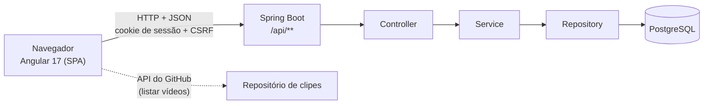

# 🏀 BaskStats

**Plataforma web de análise de desempenho para a comissão técnica do time feminino de basquete do Sesi Araraquara.**


---

## Sobre o projeto

O BaskStats foi desenvolvido em parceria com o **Sesi Araraquara** para que os treinadores do time feminino de basquete analisem os dados das atletas e tomem decisões melhores nos jogos e nos treinos.

A aplicação transforma estatísticas brutas de partidas em informação para decisão: como a equipe está na temporada, como cada atleta está rendendo, quem é o próximo adversário, o que aconteceu no último jogo e o que vale a pena treinar.

<!-- CONFIRMAR: a carga dos dados de jogo (partidas, estatísticas, clipes) é feita por um processo externo de coleta (scraper), que não está neste repositório? Pelos comentários do script SQL, sim; ajuste a frase abaixo se não for isso. -->
A aplicação apenas **consulta** os dados de jogo; a carga é feita por um processo de coleta externo ao código deste repositório.

## Funcionalidades

| Tela | O que entrega |
|---|---|
| **Painel** | Visão geral da temporada: vitórias e derrotas, pontos por rodada (últimas 10), aproveitamento de arremessos (2 pontos, 3 pontos e lance livre), maiores pontuadoras e média de pontos por posição |
| **Jogadoras** | Elenco do time com camisa, posição e pontos por jogo; página individual com pontos, rebotes, assistências, roubos, perdas de bola, eficiência e aproveitamento de arremessos |
| **Pré-jogo** | Números do **próximo adversário**, para preparar o jogo |
| **Pós-jogo** | Estatísticas da **última partida disputada**, com placar por quarto |
| **Vídeos** | Clipes de lances filtrados por categoria (ataque, defesa, finalizações, rebote ofensivo) e playlists salvas |
| **Treinos** | Plano de treino por fundamento, com meta, tendência dos últimos jogos e recomendação de treino por atleta |
| **Acesso restrito** | Login com sessão, proteção CSRF e opção "lembrar de mim" |

### Plano de treino

A tela de treinos usa a rota `GET /api/times/{id}/treinos/plano`. Para o fundamento escolhido (arremesso de 3, de 2, lance livre, pontos, rebotes, assistências, roubos, perdas de bola, eficiência ou minutos), o sistema:

1. calcula a média da temporada de cada atleta e a média dos últimos N jogos (de 1 a 30);
2. mede a **distância até a meta** (em perdas de bola a lógica se inverte, porque menos é melhor);
3. calcula a **tendência recente** (média recente menos média da temporada);
4. classifica cada atleta como `ATINGIDA` ou `EM_FOCO` e ordena quem está mais longe da meta primeiro;
5. anexa uma recomendação de treino escolhida por **regras fixas**.

> São regras determinísticas, não inteligência artificial. As metas padrão (por exemplo, 35% nos arremessos de 3) são configuráveis na tela.

## Arquitetura



- **Front-end e back-end separados**: o Angular cuida da experiência de uso; o Spring cuida de regras, segurança e dados. Cada lado evolui e é publicado de forma independente.
- **Back-end em camadas** (`controller` → `service` → `repository`): cada classe tem uma responsabilidade.
- **Acesso a dados em dois estilos**: Spring Data JPA para buscas simples por id e `JdbcClient` com SQL nativo para as análises (agregações, `lag()`, `JOIN LATERAL`), onde o SQL é mais claro e eficiente.
- **Esquema controlado por scripts SQL** (`ddl-auto=none`): o Hibernate não cria nem altera tabelas.

## Tecnologias

| Camada | Tecnologias |
|---|---|
| Back-end | Java 17, Spring Boot 4.1.1, Spring Web MVC, Spring Data JPA, Spring Security, Bean Validation, Gradle (Kotlin DSL) |
| Banco de dados | PostgreSQL |
| Front-end | Angular 17 (componentes standalone, lazy loading, signals), TypeScript 5.4, RxJS 7.8 |
| Gráficos | SVG e CSS puros, sem biblioteca externa |
| Infraestrutura | Docker (build multi-stage) |

## Estrutura do repositório

```
BaskStats/
├── baskstats-spring/              # API REST (Spring Boot)
│   ├── src/main/java/com/baskstats/
│   │   ├── config/                # segurança (sessão, CSRF, BCrypt)
│   │   ├── controller/            # endpoints HTTP
│   │   ├── service/               # regras de negócio
│   │   ├── repository/            # acesso a dados (JPA e SQL nativo)
│   │   └── model/                 # entidades e DTOs
│   ├── src/main/resources/
│   │   ├── application.properties
│   │   └── db/migration/          # scripts SQL do esquema (V1 e V2)
│   └── dockerfile
└── baskstats-angular/             # interface web (Angular)
    ├── src/app/                   # rotas, serviços e componentes
    ├── img/                       # imagens e fonte
    └── proxy.conf.json            # proxy de /api para o back-end (desenvolvimento)
```

## Como executar

### Pré-requisitos

- Java 17
- Node.js 18.13+ ou 20+ e npm
- PostgreSQL (apenas para rodar a API com dados reais)

### 1. Somente o front-end (modo demonstração)

Não precisa de banco nem de API. Na tela de login, clique em **Explorar demonstração** para navegar com dados de exemplo.

```bash
cd baskstats-angular
npm install
npx ng serve
```

Acesse http://localhost:4200.

### 2. Banco de dados

O esquema está em `baskstats-spring/src/main/resources/db/migration/`:

- `V1__postgresql_base.sql`: tabelas de temporadas, times, jogadoras, partidas, estatísticas, quartos, lances e clipes;
- `V2__users_positions_playlists_trainings.sql`: usuários, playlists, treinos, posição no elenco e índices.

O projeto **não** usa Flyway: os scripts precisam ser aplicados manualmente, na ordem.

```bash
createdb baskstats
psql -d baskstats -f baskstats-spring/src/main/resources/db/migration/V1__postgresql_base.sql
psql -d baskstats -f baskstats-spring/src/main/resources/db/migration/V2__users_positions_playlists_trainings.sql
```

<!-- CONFIRMAR: as consultas de análise leem a coluna jogadora.posicao, mas o script V2 adiciona posicao na tabela elenco. Confirme em qual tabela a coluna existe no banco real e ajuste os scripts ou as consultas. Depois disso, atualize esta seção. -->
Os scripts criam apenas a estrutura. Nenhum dado de produção é carregado por eles.

### 3. API (Spring Boot)

Configure as variáveis de ambiente e suba a aplicação:

```bash
cd baskstats-spring

export DB_URL=jdbc:postgresql://localhost:5432/baskstats
export DB_USER=postgres
export DB_PASSWORD=sua_senha
export ADMIN_EMAIL=treinador@exemplo.com
export ADMIN_PASSWORD=uma_senha_forte

./gradlew bootRun        # no Windows: gradlew.bat bootRun
```

A API sobe em http://localhost:8080. Para conferir: `GET /api/health` retorna `{"status":"UP"}`.

| Variável | Obrigatória | Descrição |
|---|---|---|
| `DB_URL` | Sim | URL JDBC do PostgreSQL |
| `DB_USER` | Sim | Usuário do banco |
| `DB_PASSWORD` | Sim | Senha do banco |
| `ADMIN_EMAIL` | Sim | E-mail do usuário administrador |
| `ADMIN_PASSWORD` | Sim | Senha do administrador (guardada com BCrypt em memória) |
| `PORT` | Não | Porta HTTP (padrão `8080`) |

### 4. Front-end com a API

Com a API rodando em `localhost:8080`, inicie o Angular. O `proxy.conf.json` encaminha `/api` para a porta 8080, então navegador e API ficam na mesma origem e não é necessário configurar CORS.

```bash
cd baskstats-angular
npm install
npx ng serve
```

Entre em http://localhost:4200 com `ADMIN_EMAIL` e `ADMIN_PASSWORD` (a senha precisa ter ao menos 8 caracteres).

### Docker (API)

O Dockerfile usa a **raiz do repositório** como contexto de build:

```bash
docker build -f baskstats-spring/dockerfile -t baskstats-api .

docker run -p 8080:8080 \
  -e DB_URL=jdbc:postgresql://host.docker.internal:5432/baskstats \
  -e DB_USER=postgres -e DB_PASSWORD=sua_senha \
  -e ADMIN_EMAIL=treinador@exemplo.com -e ADMIN_PASSWORD=uma_senha_forte \
  baskstats-api
```

A imagem contém somente a API. O build do Angular (`npx ng build`) gera arquivos estáticos em `dist/baskstats`.

## API

Todas as rotas de `/api/**` exigem sessão autenticada, exceto as marcadas como públicas. Requisições que alteram dados exigem o token CSRF.

| Método | Rota | Descrição |
|---|---|---|
| `GET` | `/api/health` | Verifica a API e a conexão com o banco (público) |
| `GET` | `/api/auth/csrf` | Emite o token CSRF (público) |
| `POST` | `/api/auth/login` | Autentica e cria a sessão (público) |
| `GET` | `/api/auth/me` | Usuário da sessão atual |
| `POST` | `/api/auth/logout` | Encerra a sessão |
| `GET` | `/api/times` | Lista os times |
| `GET` | `/api/times/{id}/dashboard` | Painel da temporada |
| `GET` | `/api/times/{id}/jogadoras` | Elenco com estatísticas |
| `GET` | `/api/jogadoras/{id}/estatisticas` | Estatísticas de uma atleta |
| `GET` | `/api/times/{id}/pre-jogo` | Números do próximo adversário |
| `GET` | `/api/times/{id}/pos-jogo` | Última partida e placar por quarto |
| `GET` | `/api/times/{id}/treinos/plano` | Plano de treino (`foco`, `meta`, `ultimosJogos`, `posicao`) |
| `GET` | `/api/clipes` | Clipes de vídeo |
| `GET` `POST` `PUT` `DELETE` | `/api/playlists` | Playlists do usuário |
| `GET` `POST` `PUT` `DELETE` | `/api/treinos` | Treinos cadastrados pelo usuário |

Também existem `GET /api/jogadoras`, `GET /api/jogadoras/{id}/medias`, `GET /api/lances/{id}` e `GET /api/partidas/{id}`.

## Segurança

- **Sessão** com cookie `JSESSIONID` (`httpOnly`, `SameSite=Lax`): 30 minutos, ou 7 dias com "lembrar de mim". A sessão anterior é invalidada no login.
- **CSRF** com cookie `XSRF-TOKEN`; o Angular devolve o valor no cabeçalho `X-XSRF-TOKEN` nas requisições que alteram dados.
- **BCrypt** para a senha; credenciais do administrador vindas de variáveis de ambiente, nunca do código.
- **Limite de tentativas de login**: 10 por IP e e-mail em 15 minutos (depois, HTTP 429).
- **Validação de entrada** com Bean Validation (`@NotBlank`, `@Email`, `@Size`, `@Positive`).
- **SQL com parâmetros nomeados**, o que previne SQL injection.
- **Isolamento por usuário**: playlists e treinos são filtrados pelo e-mail do dono diretamente no SQL.

## Limitações conhecidas e próximos passos

Esta é uma versão de projeto acadêmico. Os pontos abaixo são conhecidos e já têm caminho de evolução:

- **Um único usuário**: o administrador é definido por variável de ambiente e mantido em memória. Próximo passo: usuários e papéis no banco (a tabela `usuario` já existe no esquema).
- **Sessão em memória**: com mais de uma instância da API seria necessária sessão compartilhada (Spring Session com JDBC ou Redis).
- **Esquema aplicado manualmente**: adotar Flyway para versionar e aplicar os scripts automaticamente.
- **Resultados das análises sem tipagem**: as consultas analíticas retornam `Map<String, Object>`. Próximo passo: DTOs com `record`.
- **Rotas sem tela**: criação e edição de playlists e o CRUD de `/api/treinos` existem na API, mas a interface atual ainda não os usa.
- **Vídeos via API do GitHub**: a API sem autenticação limita 60 requisições por hora por IP. Próximo passo: armazenamento de objetos com CDN.
- **Sem paginação nem cache** nas listagens.
- **Tocos** não existem no modelo de dados; a tela informa "não registrado".
- **Testes**: o front tem Playwright configurado, mas ainda sem testes escritos.

## Equipe

Projeto acadêmico desenvolvido por um grupo de 6 integrantes, em parceria com o Sesi Araraquara.

<!-- Preencha com nome e perfil do GitHub de cada integrante:

| Integrante | GitHub |
|---|---|
| Nome Sobrenome | [@usuario](https://github.com/usuario) |

-->
